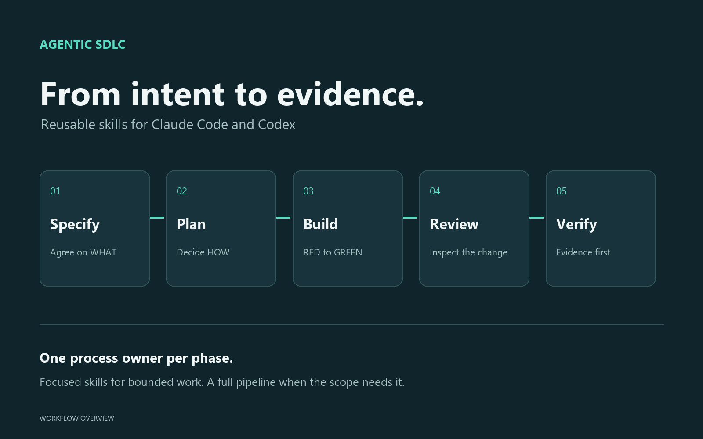

# AGENTIC-SDLC For Codex

This plugin packages AGENTIC-SDLC for Codex using the shared root `skills/` tree, a Codex manifest, and Codex interface metadata.

## Load Model

Codex reads:

| File | Purpose |
|---|---|
| `.codex-plugin/plugin.json` | Supported compatibility manifest carrying Codex hooks and presentation. |
| `skills/*/SKILL.md` | Shared skill source. |
| `hooks/hooks-codex.json` | Codex hook config: blocking `PreToolUse`, bootstrap `SessionStart`, and advisory/env-gated `Stop` backstops after hook review/trust. |

The manifest explicitly points to:

```json
{
  "skills": "./skills/"
}
```

The `interface` block supplies display metadata, capabilities, default prompts and bundled square icon/logo assets. It declares no `screenshots` key and no interface website, privacy or terms link; each such link is added only once its [link-check record](../docs/publication/link-checks.json) shows an unauthenticated 200 (BR7, BR8). The documentation overview below illustrates the process and is not runtime evidence.



The [official packaging guide](https://developers.openai.com/plugins/build/plugins) supports a standalone compatibility manifest as well as portable root `plugin.json`. This package retains its existing format; no migration is required for the current local contract. Native install, discovery, recopy and removal passed on 2026-10-12 with codex-cli **0.162.1** (Windows, macOS) and **0.156.1** (Linux); see the [compatibility matrix](../docs/publication/compatibility-matrix.md) (E2, E6, E11). An earlier isolated 0.160.1 installation discovered 16 skills and eight untrusted hooks. The **0.154.0** portable comparison (16 skills, zero portable hooks versus eight compatibility hooks) is historical evidence, not a current portable-loader claim. See [0.160.1 preparation evidence](../docs/publication/codex-0.160.1-readiness.md) and [runtime evidence and limits](../docs/runtime-adapter.md).

## Distribution paths

Four paths exist; each has its own go condition and state. Per-path verdicts are bound to the [release evidence ledger](../docs/release-evidence-0.5.0.md) (the 0.4.3 verdicts stay in the [0.4.3 ledger](../docs/release-evidence-0.4.3.md)); new preparation results are recorded separately. `codex plugin --help` on 0.160.1 still lists no validate command, so use native discovery, the local gate and archive verification without inventing that subcommand.

Public directory distribution uses a separate `--skills-only` projection: the manifest has no hooks; reusable specialist and git-review instructions live in skill references; only required stdlib helpers ship. Public installation provides procedural guidance. Manual local distribution retains hooks and requires native review/trust. See the [public packet](../docs/publication/openai-skills-only.md).

| Path | Prerequisites | Steps | Go condition | State |
|---|---|---|---|---|
| Claude own marketplace | Claude Code; see [`../.claude-plugin/README.md`](../.claude-plugin/README.md). | `claude plugin marketplace add <package-directory>` (or `MrBekoX/agentic-sdlc` once the repository is public), then `claude plugin install agentic-sdlc@mrbekox`. | Go condition: a public repository, both strict Claude manifest validations passing, and a recorded clean install. | State: BLOCKED. The repository is private and its unauthenticated URL returns 404. |
| Claude community marketplace submission | A public repository, a clean-package validation result and maintainer form access. | Submit through the Anthropic form; packet [`docs/publication/claude-community.md`](../docs/publication/claude-community.md). | Go condition: public repository and a passing `claude plugin validate` on the submitted root; acceptance is not guaranteed. | State: BLOCKED. Needs a public repository, validation and form access. |
| Codex personal marketplace | Codex with marketplace support; Node on the hook `PATH`; a package directory or another discoverable marketplace source. | `codex plugin marketplace add <package-directory>`, then `codex plugin add agentic-sdlc@mrbekox` (see [Install](#install)); open `/hooks` and trust each hook; run `python3 scripts/check_codex_hook_trust.py --plugin agentic-sdlc@<marketplace-name> --cwd <target-project>` from the installed plugin root or any package copy (a standalone script; needs Python 3.12) and expect `codex_hook_trust=trusted` ([Codex hook trust](../docs/troubleshooting.md#codex-hook-trust)). | Go condition: discoverable catalog; native `plugin/read` shows 16 skills and `hooks/list` shows 8 hooks; native `/hooks` trust review completed. The `@personal` catalog below is an optional alternative. | State: GAP. Native install, skill discovery, recopy and removal of a package built from main `1a9ac73` are recorded (E2, E6, E11 in the [compatibility matrix](../docs/publication/compatibility-matrix.md); `hooks/list` was not part of those runs); final-package discovery of 16 skills and 8 hooks and real-profile hook trust are not yet recorded in the ledger. |
| OpenAI public directory | Maintainer-verified identity and Apps Management Write (`api.apps.write`). | Build the deterministic skills-only projection (Codex manifest, skills and merged references, three required stdlib helpers, contracts, assets and `LICENSE`; lifecycle hooks are excluded) with `python3 scripts/build_release.py --output <zip> --skills-only`, verify it with `--verify`, then upload; packet [`docs/publication/openai-skills-only.md`](../docs/publication/openai-skills-only.md). | Go condition: a verified skills-only archive (`archive_kind=skills-only`); submission, acceptance and publication are three separate stages; after publication the listing changes only through a newly reviewed version ([app review](https://developers.openai.com/plugins/deploy/app-review)). | State: BLOCKED. Needs verified identity, `api.apps.write` and a verified skills-only archive. |

## Install

Get the package: a package directory is an extracted copy of this repository's files. Clone the repository, or download and extract its source ZIP or a release archive (maintainers build one with `python3 scripts/build_release.py --output agentic-sdlc.zip`; GitHub Releases are not published yet). Keep `#` out of the path: Codex reads `#` as a ref separator. Nothing inside the folder needs editing.

```bash
codex plugin marketplace add <package-directory>
codex plugin add agentic-sdlc@mrbekox
```

`mrbekox` is the catalog name in the package's `.claude-plugin/marketplace.json`, which uses Claude's marketplace schema; current Codex recognizes that legacy layout as well as native `.agents/plugins/marketplace.json`. Once the repository is public, `codex plugin marketplace add MrBekoX/agentic-sdlc` can replace the directory source; repository visibility/authentication governs Git installation, and the repository is private today. Codex installs a package copy and supplies its `PLUGIN_ROOT` to hook processes; no maintainer checkout, fixed drive, home directory, or cache location is required. See the [marketplace launch contract](../docs/runtime-adapter.md#codex-marketplace-hook-launch-contract).

Start a new Codex thread after install or reinstall so the runtime reloads plugin skills and hooks. Each bundled hook must be trusted before it runs: open `/hooks`, review the plugin commands, trust each agentic-sdlc hook, then run the hook trust check from the distribution table above and expect `codex_hook_trust=trusted`.

### Optional: personal catalog

Instead of adding the package directory, you can list the plugin in Codex's default personal marketplace at `~/.agents/plugins/marketplace.json`. This needs manual path setup. The example below points at `~/plugins/agentic-sdlc`, which can be a real copy of the package directory or a symlink/junction to it. The personal catalog root is the home directory, so its `./plugins/agentic-sdlc` source path resolves to `~/plugins/agentic-sdlc`. These paths describe the example source, not the installed hook location.

Example `~/.agents/plugins/marketplace.json` — if the file already exists, add only the `agentic-sdlc` entry to its `plugins` array; do not replace the file or other entries:

```json
{
  "name": "personal",
  "interface": {
    "displayName": "Personal"
  },
  "plugins": [
    {
      "name": "agentic-sdlc",
      "source": {
        "source": "local",
        "path": "./plugins/agentic-sdlc"
      },
      "policy": {
        "installation": "AVAILABLE",
        "authentication": "ON_INSTALL"
      },
      "category": "Developer Tools"
    }
  ]
}
```

```bash
codex plugin add agentic-sdlc@personal
```

`@personal` is an optional local authoring alternative, not a requirement. Avoid installing the same plugin from both sources; Codex can then list it twice.

### Update and uninstall

For update/uninstall, distinguish catalog refresh from recopying the installed
plugin. Use the [five-platform lifecycle guide](../docs/publication/multi-platform-distribution.md).
For a refreshed local source, repeat `codex plugin add agentic-sdlc@<marketplace-name>`;
native 0.162.1 and 0.156.1 recopied it in the isolated lifecycle tests (E2, E6, E11).
For a Git catalog, `codex plugin marketplace upgrade <marketplace-name>` refreshes the
catalog; that path has not been natively verified.
`codex plugin remove agentic-sdlc@<marketplace-name>` removes this plugin's local
cache and configuration; retain unrelated plugins and settings. CLI 0.162.1 has
no `codex plugin update` command.

## Runtime Root

Codex substitutes no plugin-root variable in skill text. Skills name bundled files as `<runtime-root>/...` and carry the **Plugin root** rule: `<runtime-root>` is the installed plugin folder, two levels above the loaded `SKILL.md`. The Codex skill listing shows that `SKILL.md` as an absolute path; after hook trust, the `SessionStart` hook also prints `Plugin root (resolved by this hook; use this absolute path wherever a skill says <runtime-root>, quoted for your shell): <path>`. If neither confirms the root, the skill stops and reports `plugin root unresolved`; it never falls back to the working directory.

`PLUGIN_ROOT` is exported only to hook processes. In the model's Bash or PowerShell it is empty (PowerShell expands `${PLUGIN_ROOT}` to an empty string), so never run a `${PLUGIN_ROOT}` command there.

Examples; replace `<runtime-root>` with the absolute path, quoted for your shell:

```bash
python3 "<runtime-root>/scripts/detect_context.py" --path .
python3 "<runtime-root>/scripts/validate_artifacts.py" --mode plan --file docs/agentic-sdlc/plans/example.md --spec docs/agentic-sdlc/specs/example.md --strict
```

Do not use `${CLAUDE_PLUGIN_ROOT}` in Codex-only examples.

## Routing And Pipeline Use

Codex uses activated skill instructions and available Codex tools. It does not expose the same Claude Code `Skill`, `Workflow`, and `Agent` transcript events.

`using-agentic-sdlc` still routes narrow work to the smallest sufficient independent skill. `agentic-sdlc-pipeline` remains the full-envelope escalation path for end-to-end or high-risk work.

## Pipeline Behavior In Codex

Codex has no Claude Code Workflow runtime. Therefore `agentic-sdlc-pipeline` does not call the `spec-plan-draft` JavaScript workflow. It uses the embedded author/critic adapter:

Emit `Runtime: Codex` once. At each gate below, emit `Codex Adapter Gate: <gate>` so `codex exec --json` transcripts have deterministic evidence. When Codex has no native `Skill` transcript event, record `Delegation Degraded: native Skill transcript events unavailable`; the adapter still runs the step by loading or activating the relevant `SKILL.md` instructions.

1. Activate `dispatch-strategy` before heavy, independent, or parallel decisions.
2. Run `<runtime-root>/scripts/detect_context.py`, with `<runtime-root>` resolved as described under [Runtime Root](#runtime-root).
3. Draft the spec inside `agentic-sdlc-pipeline` using the spec contract and `spec-plan-author` role instructions.
4. Run a fresh-context critic pass with `spec-plan-critic` instructions when Codex subagents are available; otherwise record a degraded inline critic pass.
5. Save `docs/agentic-sdlc/specs/<work_id>.md` and run `validate_artifacts.py --mode spec`.
6. Draft and critic-review the plan inside `agentic-sdlc-pipeline`.
7. Save `docs/agentic-sdlc/plans/<work_id>.md` and run `validate_artifacts.py --mode plan --strict`.
8. Activate the selected core workflow skill before implementation edits.
9. Activate `security-audit`, `implementation-control`, and `completion-claim-gate` at their gates.

During Codex pipeline and eval runs, do not run recursive cleanup deletes for generated caches such as `__pycache__`. Leave or report them instead; cleanup is not a pipeline gate and may create permission-denial noise in procedure transcripts.

`spec-authoring` and `plan-authoring` remain standalone prompt-level skills. They are not internal pipeline substeps.

## How Independent Skills Feed The Pipeline

Focused skills are independently routable in Codex and also serve as pipeline building blocks:

| Pipeline need | Skill |
|---|---|
| New feature or endpoint | `feature-build` |
| Bug or regression | `root-cause-fix` |
| Behavior-preserving refactor | `safe-refactor` |
| Test-only work | `test-authoring` |
| Execution mechanism choice | `dispatch-strategy` |
| Security gates | `security-audit` |
| Pre-final audit | `implementation-control` |
| Final evidence claim | `completion-claim-gate` |

## Hooks In Codex

The Codex manifest declares `"hooks": "./hooks/hooks-codex.json"`. It wires blocking `PreToolUse` guards for commit secrets, destructive shell commands, branch policy, literal writes, and opt-in flow ordering; `SessionStart` bootstrap context; and `Stop` continuation backstops for completion claims and flow evidence. Every handler reads `process.env.PLUGIN_ROOT` inside fixed Node launch code, then imports its `pathToFileURL()` URL. `commandWindows` selects `node.exe`; POSIX/WSL select `node`. No installed-root bytes enter shell code; hook cwd remains the session project. The config is deliberately NOT named `hooks/hooks.json`: Claude Code would auto-load that default filename with the wrong root variable. Non-managed plugin-bundled command hooks require Codex review/trust before they run. Several controls remain intentionally bounded: branch blocking and flow ordering are env-gated, Stop hooks continue the turn rather than undoing effects, and parser errors fail open.

## Requirements

- Codex CLI/runtime with plugin marketplace support. Native install, discovery, recopy and removal passed on 2026-10-12 with codex-cli 0.162.1 (Windows, macOS) and 0.156.1 (Linux); see the [compatibility matrix](../docs/publication/compatibility-matrix.md). No model turn ran and no hook trust was granted in those checks. Earlier 0.160.1 Windows discovery (2026-10-06) and historical 0.154.0 live captures retain their original platform and scope. Neither the captured 0.154.0 CLI nor 0.160.1 exposes `codex plugin validate`.
- Node.js on the hook process `PATH`: `node.exe` on native Windows, `node` on POSIX/WSL. A marketplace install does not install Node.
- Python 3 for helper scripts (3.12 tested; the helpers skills run are kept import-compatible with Python 3.8 by a static check). The hook trust check and other maintainer tooling (`build_release.py`, `bump_version.py`, eval runners) need Python 3.12. On Windows, use `py -3` when `python3` is missing or is the Microsoft Store alias.
- Git for branch, diff, commit, PR, and worktree flows.

## Evaluation

Codex trigger evidence is not directly comparable to Claude Code trigger evidence. `scripts/run_codex_trigger_eval.py` is a route-classifier proxy because Codex does not expose Claude-style `Skill` tool events in the same way.

Use Codex eval output as evidence for Codex routing only. Use procedure transcripts or runtime-adapter evidence patterns to support claims about the pipeline following its Codex path.

## Artifact Layouts And Per-Package Evidence

Work-package artifacts resolve in two layouts: the legacy flat `docs/agentic-sdlc/{specs,plans}/<id>.md` (back-compat, unchanged) and the per-package canonical `docs/agentic-sdlc/<slug>/{spec,plan,evidence}/<work_id>.md`, where `<slug>` is lowercase kebab-case `^[a-z0-9][a-z0-9-]{0,63}$` and never a reserved name (`specs`, `plans`, `evidence`, `notes`, `spec`, `plan`).

Per-package evidence persists to `docs/agentic-sdlc/<slug>/evidence/<work_id>.md` — per-package only (flat packages get no evidence), overwritten in place per run (single canonical file, last run wins), git-ignored, and with no validator (it never gates resolution). That evidence write is performed by the main pipeline finalize step, not the read-only `implementation-auditor` sub-agent.

Per-package plan change-detection runs as a filesystem scan, not a `git status` query: new generated plans can be git-ignored, so the resolver scans the filesystem; published plugin documentation is tracked separately.

## Troubleshooting

See [`../docs/troubleshooting.md`](../docs/troubleshooting.md) for plugin loading, missing Node, Codex eval warnings, and common procedure-eval failures.
