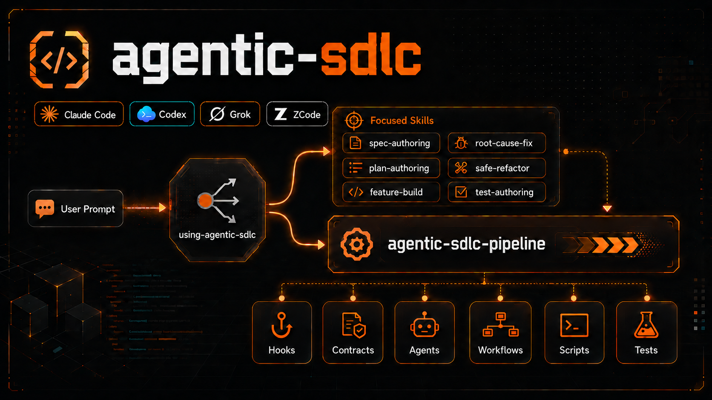

# agentic-sdlc



> A local AGENTIC-SDLC plugin for **Claude Code** and **Codex**. It packages repeatable software-delivery procedure as skills, hooks, contracts, scripts, agents, workflows, and eval fixtures.
>
> `Version 0.4.3` - `MIT` - `Author: Beko` - <https://github.com/MrBekoX/agentic-sdlc>

---

## Scope

This repository supports two runtimes:

| Runtime | Read this first | Plugin entry point |
|---|---|---|
| Claude Code | [`.claude-plugin/README.md`](.claude-plugin/README.md) | [`.claude-plugin/plugin.json`](.claude-plugin/plugin.json) + [`.claude-plugin/marketplace.json`](.claude-plugin/marketplace.json) |
| Codex | [`.codex-plugin/README.md`](.codex-plugin/README.md) | [`.codex-plugin/plugin.json`](.codex-plugin/plugin.json) |

Other harnesses are intentionally deferred. [`docs/runtime-adapter.md`](docs/runtime-adapter.md) may mention adapter concepts for future or experimental portability, but Claude Code and Codex are the supported release targets. ZCode (Z.ai) exists only as an **experimental adapter** for local personal-marketplace installs — see [`.zcode-plugin/README.md`](.zcode-plugin/README.md); it is not a supported release target. Grok CLI exists only as an **experimental adapter** for local personal-marketplace installs — see [`.grok-plugin/README.md`](.grok-plugin/README.md); it is not a supported release target.

## Distribution paths

`agentic-sdlc` has four release-gated distribution paths. Each one has its own prerequisites, steps, go condition and state. A state is a snapshot bound to the [release evidence ledger](docs/release-evidence-0.4.3.md); the per-path go/no-go verdicts live in [release readiness](docs/release-readiness.md#distribution-paths-and-gono-go). Ready to submit never means submitted, accepted or published. Additional experimental ZCode and Grok CLI local installs exist outside the four release-gated paths; they carry no 0.4.3 verdict.

### Claude own marketplace

**Prerequisites.** Claude Code with plugin marketplace support, `node` on `PATH`, and read access to `MrBekoX/agentic-sdlc`.

**Steps.** Add this repository as a plugin marketplace, then install the plugin:

```text
/plugin marketplace add MrBekoX/agentic-sdlc
/plugin install agentic-sdlc@mrbekox
```

For local development from a clone, point Claude Code at the repo root instead:

```text
claude --plugin-dir /path/to/agentic-sdlc
```

After install, the `using-agentic-sdlc` router is available as a skill. Claude Code slash-command discovery comes from `commands/`, and Claude namespaces plugin commands as `<plugin>:<command>`, so this plugin's manual command is `/agentic-sdlc:git-safety-check`.

**Go condition.** Anonymous users need a public repository. A private repository installs only through a git credential helper or SSH; a token supplied only in an environment variable does not authenticate the install ([private repositories](https://code.claude.com/docs/en/plugin-marketplaces.md#private-repositories), observed 2026-09-14). `claude plugin validate .claude-plugin/marketplace.json --strict` and `claude plugin validate .claude-plugin/plugin.json --strict` pass as two separate checks: marketplace validation checks no plugin contents, and hook-config validity comes from the repository tests. A strict `plugin.json` exit 1 in a working tree, caused by the untracked `CLAUDE.md`, is not the clean-package result. The clean install starts from an empty profile: `/plugin marketplace add MrBekoX/agentic-sdlc`, `/plugin install agentic-sdlc@mrbekox`, a new session or `/reload-plugins`, then skill, command and hook discovery plus one real invocation, with the clone transport (SSH or HTTPS) recorded.

State: BLOCKED. The repository is private, its unauthenticated URL returns 404 in [`docs/publication/link-checks.json`](docs/publication/link-checks.json), and visibility stays blocked by an unresolved Git history finding (ledger row `history_private_path_finding`).

### Claude community marketplace submission

**Prerequisites.** A public repository, a recorded clean-package `claude plugin validate` result, and maintainer access to a submission form: the claude.ai form needs a Team or Enterprise plan with directory management, and the Console form needs a Developer, Admin or Owner role.

**Steps.** Submit the plugin root through the Anthropic plugin submission form ([claude.com/docs/plugins/submit](https://claude.com/docs/plugins/submit)). The prepared packet is [`docs/publication/claude-community.md`](docs/publication/claude-community.md).

**Go condition.** The repository must be public, and `claude plugin validate` must pass on the submitted plugin root ([claude.com/docs/plugins/submit](https://claude.com/docs/plugins/submit), observed 2026-09-14). Acceptance is not guaranteed. Two Anthropic statements, both observed 2026-09-14, govern updates: [code.claude.com/docs/en/plugins](https://code.claude.com/docs/en/plugins.md) says approved plugins "are pinned to a specific commit SHA" and that CI bumps the pin automatically as new commits are pushed, and [claude.com/docs/plugins/submit](https://claude.com/docs/plugins/submit) says "updates pushed to your GitHub repo are picked up automatically". Every default-branch push after approval therefore counts as publication. The two pages name different target marketplaces, `claude-community` (the code.claude.com community-marketplace section) and `claude-plugins-official` (the claude.com submit page), as recorded on 2026-09-14; neither placement is promised.

State: BLOCKED. The path needs a public repository, the clean-package validation result and maintainer form access.

### Codex personal marketplace

**Prerequisites.** Codex CLI 0.154.0 with plugin marketplace support, `node` on `PATH`, and this plugin at `~/plugins/agentic-sdlc` (a real copy, or a symlink/junction to this clone).

**Steps.** The personal catalog root is the home directory, so the `./plugins/agentic-sdlc` source path below resolves to `~/plugins/agentic-sdlc`.

Example `~/.agents/plugins/marketplace.json`:

```json
{
  "name": "personal",
  "interface": {
    "displayName": "Personal"
  },
  "plugins": [
    {
      "name": "agentic-sdlc",
      "source": {
        "source": "local",
        "path": "./plugins/agentic-sdlc"
      },
      "policy": {
        "installation": "AVAILABLE",
        "authentication": "ON_INSTALL"
      },
      "category": "Developer Tools"
    }
  ]
}
```

```bash
codex plugin add agentic-sdlc@personal
```

Then open `/hooks` in Codex and trust each agentic-sdlc hook. From the plugin root, run the read-only post-install check; a fully trusted install prints `codex_hook_trust=trusted`:

```bash
python3 scripts/check_codex_hook_trust.py --plugin agentic-sdlc@personal
```

The per-environment trust steps, Codex config locations and exit codes are in [Codex hook trust](docs/troubleshooting.md#codex-hook-trust).

`@personal` is the supported local install. Codex 0.153.0+ also has `codex plugin marketplace add`, but this repo's `.claude-plugin/marketplace.json` is Claude's marketplace schema and not the supported Codex install path. Codex 0.154.0 can read it as a legacy-compatible layout, and `codex plugin marketplace add MrBekoX/agentic-sdlc` surfacing the `mrbekox` marketplace has been observed, but that route is unsupported. Installing both routes can list the plugin twice, once from `mrbekox` and once from `personal`.

The same skills run through the embedded author/critic adapter where Claude-only Workflow/Skill tooling is unavailable.

**Go condition.** A catalog at `~/.agents/plugins/marketplace.json` with top-level `"name": "personal"`; install through `codex plugin add agentic-sdlc@personal`; native `plugin/read` showing 16 skills and `hooks/list` showing 8 hooks; and hook trust granted through the native `/hooks` trust protocol as a required step.

State: GAP. Final-package discovery of 16 skills and 8 hooks and real-profile hook trust are not yet recorded in the ledger.

### ZCode personal marketplace (experimental, not a release-gated path)

> **Experimental adapter.** ZCode is not a supported 0.4.3 release target; this local install path carries no go/no-go verdict and no official submission exists. See [`docs/runtime-adapter.md`](docs/runtime-adapter.md).

**Prerequisites.** The ZCode desktop client, `node` on `PATH`, and this clone.

**Steps.** ZCode discovers `.zcode-plugin/plugin.json`, a flat `skills/<name>/SKILL.md` layout, and loads the separate [`hooks/hooks-zcode.json`](hooks/hooks-zcode.json) wire declared by the manifest (`hooks/hooks.json` is never created — ZCode auto-loads that standard location).

1. **Settings → Plugins → Discover**, click **+** (**Create → Add marketplace**), and add this repository root — the folder containing the root [`marketplace.json`](marketplace.json), written in the ZCode marketplace schema (`name=mrbekox`, `source="./"`, `category=developer-tools`).
2. In the **Personal** segment, **Install** then **Enable** the `agentic-sdlc` card.
3. Start a new session, then check **Settings → Skills** (16 plugin skills), **Settings → Hooks** (plugin hook entries), and invoke `$using-agentic-sdlc` once.

**Go condition (adapter only).** Discovery evidence: the plugin card lists name/version/category, all 16 skills appear under plugin skills, the wired hooks appear read-only under Hooks, and one router invocation routes to a focused skill. Recorded evidence does not upgrade ZCode to a supported release target.

State: GAP. The manifest, marketplace and hook wire exist and pass `tests/test_zcode_packaging.py`; live marketplace-add / install / discovery evidence has not been recorded yet. The official-marketplace gap list is in [`docs/publication/zcode-marketplace.md`](docs/publication/zcode-marketplace.md).

### Grok CLI personal marketplace (experimental, not a release-gated path)

> **Experimental adapter.** Grok CLI is not a supported 0.4.3 release target; this local install path carries no go/no-go verdict and no official xAI directory submission exists. `grok plugin validate .` green on the Claude layout is not Grok-native publish. See [`docs/runtime-adapter.md`](docs/runtime-adapter.md).

**Prerequisites.** Grok CLI, `node` on `PATH`, and this clone. Install with `--trust` or hooks/skills stay inactive.

**Steps.** Grok discovers `.grok-plugin/plugin.json` and `.grok-plugin/marketplace.json`, a shared `skills/<name>/SKILL.md` layout, and loads the separate [`hooks/hooks-grok.json`](hooks/hooks-grok.json) wire declared by the manifest (`hooks/hooks.json` is never created — that is Grok's auto-discovered hook file).

```text
grok plugin marketplace add .
grok plugin install agentic-sdlc --trust
grok plugin enable agentic-sdlc
grok plugin details agentic-sdlc
grok inspect
```

After install, press `r` in the Plugins tab or start a new session. The router is `/using-agentic-sdlc` (qualified `/agentic-sdlc:using-agentic-sdlc` on collision).

**Go condition (adapter only).** Discovery evidence: `grok plugin details` / `grok inspect` list all 16 house skills including `using-agentic-sdlc`, command `git-safety-check`, and `agents/*`. Recorded evidence does not upgrade Grok to a supported release target.

State: local adapter evidence recorded on grok 1.0.34. `grok plugin marketplace add .` lists this root as a source. `grok plugin install agentic-sdlc --trust` (name lookup) did not find the plugin in `--available` — Grok did not index the `source: "./"` marketplace entry for name install. `grok plugin install . --trust` on the live worktree hit Windows I/O error 5 while copying `.git`. `grok plugin install <local-path> --trust` of a git-less snapshot of this packaging, then `grok plugin enable agentic-sdlc`, succeeded: `grok plugin details` shows the Grok-facing description and hook component; `grok inspect --json` twice listed the same 16 house skills including `using-agentic-sdlc`, command `git-safety-check`, nine `agents/*` files, and `hooks/hooks-grok.json`. That evidence does not upgrade Grok to a supported release target. The personal-marketplace note is [`docs/publication/grok-marketplace.md`](docs/publication/grok-marketplace.md).

### OpenAI public directory

**Prerequisites.** Maintainer-verified identity and Apps Management Write (`api.apps.write`).

**Steps.** Build the separately defined skills-only archive (BR24 members: `.codex-plugin/`, `skills/`, `hooks/`, `contracts/skills/`, `scripts/`, `assets/` and `LICENSE`) with `python3 scripts/build_release.py --output <zip> --skills-only`, check it with `python3 scripts/build_release.py --verify <zip>`, then upload it through the OpenAI portal. The prepared packet is [`docs/publication/openai-skills-only.md`](docs/publication/openai-skills-only.md).

**Go condition.** The skills-only archive verifies as `archive_kind=skills-only`, the maintainer identity and `api.apps.write` are verified, and submission, acceptance and publication are treated as three separate stages. After publication, the listing changes only through a newly reviewed version ([app review](https://developers.openai.com/plugins/deploy/app-review)).

State: BLOCKED. The path needs the verified identity, `api.apps.write` and a verified skills-only archive.

## What It Is

| It is | It is not |
|---|---|
| A local development plugin for Claude Code and Codex | A hosted service or CI/CD platform |
| A library of reusable SDLC skills and guardrails | A general-purpose agent harness |
| A router plus an optional full-envelope pipeline | A rule that every prompt must run the full pipeline |
| Versioned, testable documentation-as-procedure | A replacement for human review and judgment |

AGENTIC-SDLC turns repeated engineering procedure into small, verifiable capabilities: read context first, specify before building, test before claiming, review before finishing.

## Architecture

The plugin is organized around one router, independent focused skills, and one full-envelope orchestrator.

```text
user prompt
  |
  v
using-agentic-sdlc
  |-- narrow intent ------------> focused skill
  |                                spec-authoring / plan-authoring / feature-build
  |                                root-cause-fix / safe-refactor / test-authoring
  |                                security-audit / code-quality-review / ...
  |
  `-- full SDLC or high risk ---> agentic-sdlc-pipeline
                                   owns outer envelope
                                   delegates implementation core
```

`using-agentic-sdlc` routes ordinary work to the smallest sufficient independent skill. Those skills are first-class entry points: users can invoke them directly, and they remain useful without the full pipeline.

`agentic-sdlc-pipeline` is the escalation path for end-to-end or high-risk work. It owns the outer envelope: git lifecycle, analysis, spec/plan phases, validation, scope lock, quality gates, security passes, final audit, and evidence-before-claim discipline. It then feeds the approved `docs/agentic-sdlc/specs/<work_id>.md` and `docs/agentic-sdlc/plans/<work_id>.md` into the matching core skill:

| Pipeline core need | Delegated skill |
|---|---|
| New feature, endpoint, or capability | `feature-build` |
| Bug, regression, or broken behavior | `root-cause-fix` |
| Behavior-preserving restructure | `safe-refactor` |
| Test-only coverage or repair | `test-authoring` |

Gate and review skills also feed the pipeline at control points: `dispatch-strategy`, `security-audit`, `implementation-control`, and `completion-claim-gate`.

Important boundary: `spec-authoring` and `plan-authoring` are standalone prompt-level skills. The pipeline does not call them for its internal spec/plan phases. Claude Code uses the `spec-plan-draft` workflow; Codex uses the embedded author/critic adapter documented in the runtime-specific README.

## Repository Layout

```text
.claude-plugin/    Claude Code manifest, local marketplace metadata, runtime README
.codex-plugin/     Codex manifest and runtime README
.grok-plugin/      Grok CLI adapter manifest + personal marketplace index (experimental)
skills/            Shared skill source: one directory per skill
agents/            Bounded sub-agent role contracts (review roles are tool-level read-only)
workflows/         Claude Code dynamic workflow scripts
hooks/             Deterministic guard scripts, flow evidence, and runtime hook wiring
contracts/skills/  Durable behavior contracts
commands/          Manual slash-command definitions
scripts/           20 Python helpers: probes, validators, eval runners, release archives, strict evidence, versioning, git-hook install, hook trust check
tests/             Unit tests, harness, fixtures, golden refs, eval seeds
docs/              Component reference, boundaries, testing, release notes
```

Skills live in root [`skills/`](skills/), not in `.claude/skills/` or `.codex/skills/`. The two runtime plugin manifests point at the shared source tree.

## Skill Inventory

### Router

| Skill | Purpose |
|---|---|
| `using-agentic-sdlc` | Session-local router. Chooses the smallest sufficient skill and escalates only when full-envelope work is needed. |

### Core Workflow Skills

| Skill | Purpose |
|---|---|
| `agentic-sdlc-pipeline` | Full-envelope SDLC orchestrator for end-to-end or high-risk implementation. |
| `spec-authoring` | Standalone WHAT flow: requirements, acceptance criteria, behavior contract. |
| `plan-authoring` | Standalone HOW flow: task breakdown, sequencing, verification strategy. |
| `feature-build` | Focused feature or endpoint implementation. |
| `root-cause-fix` | Root-cause bug fix with regression evidence. |
| `safe-refactor` | Behavior-preserving restructure guarded by characterization tests. |
| `test-authoring` | Test-only creation, repair, or strategy. |

### Gates And Review

| Skill | Purpose |
|---|---|
| `security-audit` | Security review with masked findings. |
| `code-quality-review` | Maintainability and implementation-quality review. |
| `feedback-triage` | Verify and apply reviewer, bot, PR, or CI feedback. |
| `implementation-control` | Pre-final audit that the required flow was actually followed. |
| `completion-claim-gate` | Same-turn evidence gate before any done/fixed/passing/ready claim. |

### Utilities

| Skill | Purpose |
|---|---|
| `mind-spark` | Pre-spec intent exploration for unsettled build/design requests. |
| `dispatch-strategy` | Choose main loop, sub-agent, dynamic workflow, or agent team. |
| `skill-authoring` | Create, evaluate, and package Claude Code / Codex skills. |

## Guardrails

Deterministic hook scripts live in [`hooks/`](hooks/). Runtime wiring differs:

| Runtime | Hook wiring |
|---|---|
| Claude Code | [`hooks/hooks-claude.json`](hooks/hooks-claude.json), declared by `.claude-plugin/plugin.json`: `PreToolUse`, `PostToolUse`, `SessionStart`, and `Stop` guards. The command guards match `Bash|PowerShell` and carry no `if` filter — a `Bash`-only matcher is inert on a Windows host without Git Bash, and a subcommand-level `if` never starts the hook for a git alias, so each guard self-gates internally instead. |
| Codex | [`hooks/hooks-codex.json`](hooks/hooks-codex.json), declared in `.codex-plugin/plugin.json`, after Codex hook review/trust: `SessionStart` bootstrap **plus** native blocking `PreToolUse` command guards, a pre-write secret guard, and two `Stop` backstops. See [`docs/runtime-adapter.md`](docs/runtime-adapter.md) for the exact set and its documented coverage gaps. |
| ZCode (experimental adapter) | [`hooks/hooks-zcode.json`](hooks/hooks-zcode.json), declared by `.zcode-plugin/plugin.json`: `PreToolUse` command guards on `Bash`, `PostToolUse` write scan on `Write\|Edit`, and the `SessionStart` bootstrap on `startup\|clear\|compact`, each a `process` executor (`node` on `PATH` required). Stop completion/flow guards and the flow-order guard stay unwired; see [`docs/runtime-adapter.md`](docs/runtime-adapter.md). |
| Grok CLI (experimental adapter) | [`hooks/hooks-grok.json`](hooks/hooks-grok.json), declared by `.grok-plugin/plugin.json`: `PreToolUse` command guards on `Bash\|run_terminal_command` (`type: command`, `timeout` in seconds, `${GROK_PLUGIN_ROOT}`). Write-scan, Stop, and SessionStart stay unwired; see [`docs/runtime-adapter.md`](docs/runtime-adapter.md). |

Claude Code wires flow enforcement through `flow-order-guard.mjs` and `flow-step-guard.mjs`. Codex uses its own `flow-order-guard-codex.mjs` and `flow-step-guard-codex.mjs` adapters over the same [`hooks/flow-requirements.json`](hooks/flow-requirements.json); the Codex order gate is opt-in and its Stop gate can continue the turn but cannot undo effects.

Guarding happens at two layers, because one of them provably cannot be complete.

**Command layer (PreToolUse).** Fast, runs before anything executes, and is the only layer that can stop a
write *before* it lands. It reads the RAW command string. Git aliases are resolved deterministically through
[`hooks/git-invocation.mjs`](hooks/git-invocation.mjs), but shell aliases and functions from `~/.bashrc`,
`$PATH` shadowing, `eval` and variable indirection are applied by the shell *after* the hook has decided, and
the write surface (`tee`, `dd`, `base64`, any interpreter) is unbounded. Those are documented residuals, not
oversights - deciding what an arbitrary shell command does is undecidable.

**Effect layer.** Closes exactly that class by never reading a command string:

| Guard | Fires on | Why the command-layer residuals do not apply |
|---|---|---|
| repo git hooks ([`scripts/install_git_hooks.py`](scripts/install_git_hooks.py)) | the git operation | git has already resolved its alias table; the shell has already done quote removal and `$PATH` lookup; owned hashes are recorded under the repo's git directory and external/shared `core.hooksPath` writes require an explicit opt-in |
| [`hooks/worktree-scan.mjs`](hooks/worktree-scan.mjs) (Stop) | bytes on disk | how they were written is irrelevant |

Verified against the real techniques: a shell function wrapping `git commit`, an `eval`-assembled commit,
`git $C` indirection, a secret inside an alias-supplied message, and writes via `tee`, `base64 -d` and
`python -c` are all caught. The documented limit of the effect layer is stated too: `git commit --no-verify`
skips `pre-commit` and `commit-msg`, while the installed `prepare-commit-msg` backstop still runs by Git's
design; the Stop scan is detection because the bytes are already on disk.
Non-negotiable enforcement belongs server-side (`pre-receive`) or in CI.

Judgment-based checks, such as whether context was actually read or test output was understood, live in skills and contracts rather than hook scripts. See [`hooks/README.md`](hooks/README.md).

## Quality Gate

Run the local gate before claiming repository health:

```bash
python3 scripts/bump_version.py --check
python3 scripts/check_all.py
python3 tests/skills/harness.py
python3 -m unittest discover -s tests -v
```

On Windows, use `py -3` for the same commands when `python3` is not on `PATH`.

This proves metadata consistency, static skill wiring, fixture health, hook/workflow syntax, and unit behavior. It does not prove live model routing or live runtime obedience. Live Claude/Codex evals require the corresponding CLI and auth; do not claim a skill "works" or "triggers" without eval output or a transcript.

## Artifact Layouts And Per-Package Evidence

Work-package artifacts resolve in two layouts: the legacy flat `docs/agentic-sdlc/{specs,plans}/<id>.md` (back-compat, unchanged) and the per-package canonical `docs/agentic-sdlc/<slug>/{spec,plan,evidence}/<work_id>.md`, where `<slug>` is lowercase kebab-case `^[a-z0-9][a-z0-9-]{0,63}$` and never a reserved name (`specs`, `plans`, `evidence`, `notes`, `spec`, `plan`).

Per-package evidence persists to `docs/agentic-sdlc/<slug>/evidence/<work_id>.md` — per-package only (flat packages get no evidence), overwritten in place per run (single canonical file, last run wins), git-ignored, and with no validator (it never gates resolution). That evidence write is performed by the main pipeline finalize step, not the read-only `implementation-auditor` sub-agent.

Per-package plan change-detection runs as a filesystem scan, not a `git status` query: the whole `docs/` tree is git-ignored, so `git status` never reports new per-package plans and the resolver scans the filesystem instead.

## More Documentation

- [`docs/plugin-readme.md`](docs/plugin-readme.md) - component-by-component reference.
- [`docs/skill-boundaries.md`](docs/skill-boundaries.md) - skill ownership, anti-overlap rules, and pipeline boundaries.
- [`docs/testing.md`](docs/testing.md) - deterministic gate, live evals, transcript checks.
- [`docs/troubleshooting.md`](docs/troubleshooting.md) - runtime loading, hooks, evals, and common failures.
- [`docs/release-readiness.md`](docs/release-readiness.md) - release evidence checklist.
- [`docs/data-handling.md`](docs/data-handling.md) - what the hooks and eval helpers read, write and mask on the local machine.
- [`SECURITY.md`](SECURITY.md) - supported versions, private reporting, and hook/eval trust boundaries.
- [`CONTRIBUTING.md`](CONTRIBUTING.md) and [`CODE_OF_CONDUCT.md`](CODE_OF_CONDUCT.md) - contribution gate and community expectations.

## Versioning

Current version: `0.4.3`.

```bash
python3 scripts/bump_version.py --check
python3 scripts/bump_version.py <next-version>
python3 scripts/bump_version.py --release-check
```

## Related Work And Acknowledgements

[obra/superpowers](https://github.com/obra/superpowers) influenced this project's RED/GREEN/REFACTOR
teaching loop, rationalization/red-flag review mechanics, and numbered completion-gate style. This
repository independently adds dual-runtime packaging, durable behavior contracts, artifact validators,
work-package evidence, and deterministic security/flow hooks. See
[`skills/skill-authoring/references/house-notes.md`](skills/skill-authoring/references/house-notes.md)
for the detailed derivation notes. Both projects are MIT licensed.

## License

MIT - see [LICENSE](LICENSE).
