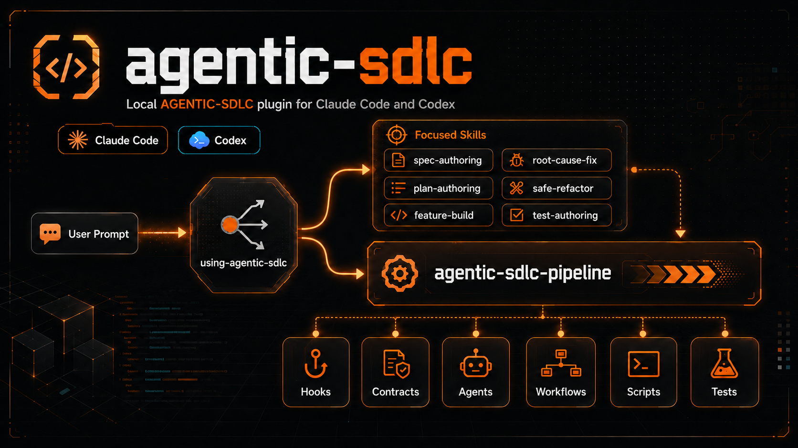

# agentic-sdlc



> A local AGENTIC-SDLC plugin for **Claude Code** and **Codex**. It packages repeatable software-delivery procedure as skills, hooks, contracts, scripts, agents, workflows, and eval fixtures.
>
> `Version 0.4.0` - `MIT` - `Author: Beko` - <https://github.com/MrBekoX/agentic-sdlc>

---

## Scope

This repository supports two runtimes:

| Runtime | Read this first | Plugin entry point |
|---|---|---|
| Claude Code | [`.claude-plugin/README.md`](.claude-plugin/README.md) | [`.claude-plugin/plugin.json`](.claude-plugin/plugin.json) + [`.claude-plugin/marketplace.json`](.claude-plugin/marketplace.json) |
| Codex | [`.codex-plugin/README.md`](.codex-plugin/README.md) | [`.codex-plugin/plugin.json`](.codex-plugin/plugin.json) |

Other harnesses are intentionally deferred. [`docs/runtime-adapter.md`](docs/runtime-adapter.md) may mention adapter concepts for future or experimental portability, but Claude Code and Codex are the supported release targets.

## Install

### Claude Code

Add this repository as a plugin marketplace, then install the plugin:

```text
/plugin marketplace add MrBekoX/agentic-sdlc
/plugin install agentic-sdlc@mrbekox
```

For local development from a clone, point Claude Code at the repo root instead:

```text
claude --plugin-dir /path/to/agentic-sdlc
```

After install, the `using-agentic-sdlc` router is available as a skill. Claude Code slash-command discovery comes from `commands/`; this plugin currently ships `/git-safety-check` as the manual command.

### Codex

Codex uses the personal marketplace layout. Put this plugin at `~/.codex/plugins/agentic-sdlc` or point that path at this clone, then install it from the personal marketplace. In the default personal marketplace, the `./plugins/agentic-sdlc` source path resolves to that plugin directory.

Example `~/.agents/plugins/marketplace.json`:

```json
{
  "name": "personal",
  "interface": {
    "displayName": "Personal"
  },
  "plugins": [
    {
      "name": "agentic-sdlc",
      "source": {
        "source": "local",
        "path": "./plugins/agentic-sdlc"
      },
      "policy": {
        "installation": "AVAILABLE",
        "authentication": "ON_INSTALL"
      },
      "category": "Developer Tools"
    }
  ]
}
```

```bash
codex plugin add agentic-sdlc@personal
```

The same skills run through the embedded author/critic adapter where Claude-only Workflow/Skill tooling is unavailable.

## What It Is

| It is | It is not |
|---|---|
| A local development plugin for Claude Code and Codex | A hosted service or CI/CD platform |
| A library of reusable SDLC skills and guardrails | A general-purpose agent harness |
| A router plus an optional full-envelope pipeline | A rule that every prompt must run the full pipeline |
| Versioned, testable documentation-as-procedure | A replacement for human review and judgment |

AGENTIC-SDLC turns repeated engineering procedure into small, verifiable capabilities: read context first, specify before building, test before claiming, review before finishing.

## Architecture

The plugin is organized around one router, independent focused skills, and one full-envelope orchestrator.

```text
user prompt
  |
  v
using-agentic-sdlc
  |-- narrow intent ------------> focused skill
  |                                spec-authoring / plan-authoring / feature-build
  |                                root-cause-fix / safe-refactor / test-authoring
  |                                security-audit / code-quality-review / ...
  |
  `-- full SDLC or high risk ---> agentic-sdlc-pipeline
                                   owns outer envelope
                                   delegates implementation core
```

`using-agentic-sdlc` routes ordinary work to the smallest sufficient independent skill. Those skills are first-class entry points: users can invoke them directly, and they remain useful without the full pipeline.

`agentic-sdlc-pipeline` is the escalation path for end-to-end or high-risk work. It owns the outer envelope: git lifecycle, analysis, spec/plan phases, validation, scope lock, quality gates, security passes, final audit, and evidence-before-claim discipline. It then feeds the approved `docs/agentic-sdlc/specs/<work_id>.md` and `docs/agentic-sdlc/plans/<work_id>.md` into the matching core skill:

| Pipeline core need | Delegated skill |
|---|---|
| New feature, endpoint, or capability | `feature-build` |
| Bug, regression, or broken behavior | `root-cause-fix` |
| Behavior-preserving restructure | `safe-refactor` |
| Test-only coverage or repair | `test-authoring` |

Gate and review skills also feed the pipeline at control points: `dispatch-strategy`, `security-audit`, `implementasyon-control`, and `completion-claim-gate`.

Important boundary: `spec-authoring` and `plan-authoring` are standalone prompt-level skills. The pipeline does not call them for its internal spec/plan phases. Claude Code uses the `spec-plan-draft` workflow; Codex uses the embedded author/critic adapter documented in the runtime-specific README.

## Repository Layout

```text
.claude-plugin/    Claude Code manifest, local marketplace metadata, runtime README
.codex-plugin/     Codex manifest and runtime README
skills/            Shared skill source: one directory per skill
agents/            Read-only sub-agent role contracts
workflows/         Claude Code dynamic workflow scripts
hooks/             Deterministic guard scripts, flow evidence, and runtime hook wiring
contracts/skills/  Durable behavior contracts
commands/          Manual slash-command definitions
scripts/           14 Python helpers: probes, validators, eval runners, versioning
tests/             Unit tests, harness, fixtures, golden refs, eval seeds
docs/              Component reference, boundaries, testing, release notes
```

Skills live in root [`skills/`](skills/), not in `.claude/skills/` or `.codex/skills/`. The two runtime plugin manifests point at the shared source tree.

## Skill Inventory

### Router

| Skill | Purpose |
|---|---|
| `using-agentic-sdlc` | Session-local router. Chooses the smallest sufficient skill and escalates only when full-envelope work is needed. |

### Core Workflow Skills

| Skill | Purpose |
|---|---|
| `agentic-sdlc-pipeline` | Full-envelope SDLC orchestrator for end-to-end or high-risk implementation. |
| `spec-authoring` | Standalone WHAT flow: requirements, acceptance criteria, behavior contract. |
| `plan-authoring` | Standalone HOW flow: task breakdown, sequencing, verification strategy. |
| `feature-build` | Focused feature or endpoint implementation. |
| `root-cause-fix` | Root-cause bug fix with regression evidence. |
| `safe-refactor` | Behavior-preserving restructure guarded by characterization tests. |
| `test-authoring` | Test-only creation, repair, or strategy. |

### Gates And Review

| Skill | Purpose |
|---|---|
| `security-audit` | Security review with masked findings. |
| `code-quality-review` | Maintainability and implementation-quality review. |
| `feedback-triage` | Verify and apply reviewer, bot, PR, or CI feedback. |
| `implementasyon-control` | Pre-final audit that the required flow was actually followed. |
| `completion-claim-gate` | Same-turn evidence gate before any done/fixed/passing/ready claim. |

### Utilities

| Skill | Purpose |
|---|---|
| `mind-spark` | Pre-spec intent exploration for unsettled build/design requests. |
| `dispatch-strategy` | Choose main loop, sub-agent, dynamic workflow, or agent team. |
| `skill-authoring` | Create, evaluate, and package Claude Code / Codex skills. |

## Guardrails

Deterministic hook scripts live in [`hooks/`](hooks/). Runtime wiring differs:

| Runtime | Hook wiring |
|---|---|
| Claude Code | [`hooks/hooks-claude.json`](hooks/hooks-claude.json), declared by `.claude-plugin/plugin.json`: `PreToolUse`, `PostToolUse`, `SessionStart`, and `Stop` guards. The command guards match `Bash|PowerShell` and carry no `if` filter — a `Bash`-only matcher is inert on a Windows host without Git Bash, and a subcommand-level `if` never starts the hook for a git alias, so each guard self-gates internally instead. |
| Codex | [`hooks/hooks-codex.json`](hooks/hooks-codex.json), declared in `.codex-plugin/plugin.json`, after Codex hook review/trust: `SessionStart` bootstrap **plus** native blocking `PreToolUse` command guards, a pre-write secret guard, and two `Stop` backstops. See [`docs/runtime-adapter.md`](docs/runtime-adapter.md) for the exact set and its documented coverage gaps. |

Claude Code also wires flow enforcement: `flow-order-guard.mjs` checks active-flow evidence before source edits, and `flow-step-guard.mjs` re-derives Stop-time evidence from artifacts, tool calls, and commands. Both read [`hooks/flow-requirements.json`](hooks/flow-requirements.json) through [`hooks/flow-evidence.mjs`](hooks/flow-evidence.mjs). Codex carries the same discipline through skills, contracts, explicit validators, and procedure transcripts in this release.

A PreToolUse hook only ever sees the RAW command string. Git aliases are resolved deterministically through [`hooks/git-invocation.mjs`](hooks/git-invocation.mjs), but shell aliases and functions from `~/.bashrc`, `$PATH` shadowing, `eval` and variable indirection are applied by the shell after the hook has already decided, and the write surface (`tee`, `dd`, `base64`, any interpreter) is unbounded. Those are documented residuals, not oversights - deciding what an arbitrary shell command does is undecidable. The command guards are a backstop, not an enforcement boundary.

Judgment-based checks, such as whether context was actually read or test output was understood, live in skills and contracts rather than hook scripts. See [`hooks/README.md`](hooks/README.md).

## Quality Gate

Run the local gate before claiming repository health:

```bash
python3 scripts/bump_version.py --check
python3 scripts/check_all.py
python3 tests/skills/harness.py
python3 -m unittest discover -s tests -v
```

On Windows, use `py -3` for the same commands when `python3` is not on `PATH`.

This proves metadata consistency, static skill wiring, fixture health, hook/workflow syntax, and unit behavior. It does not prove live model routing or live runtime obedience. Live Claude/Codex evals require the corresponding CLI and auth; do not claim a skill "works" or "triggers" without eval output or a transcript.

## Artifact Layouts And Per-Package Evidence

Work-package artifacts resolve in two layouts: the legacy flat `docs/agentic-sdlc/{specs,plans}/<id>.md` (back-compat, unchanged) and the per-package canonical `docs/agentic-sdlc/<slug>/{spec,plan,evidence}/<work_id>.md`, where `<slug>` is lowercase kebab-case `^[a-z0-9][a-z0-9-]{0,63}$` and never a reserved name (`specs`, `plans`, `evidence`, `notes`, `spec`, `plan`).

Per-package evidence persists to `docs/agentic-sdlc/<slug>/evidence/<work_id>.md` — per-package only (flat packages get no evidence), overwritten in place per run (single canonical file, last run wins), git-ignored, and with no validator (it never gates resolution). That evidence write is performed by the main pipeline finalize step, not the read-only `implementation-auditor` sub-agent.

Per-package plan change-detection runs as a filesystem scan, not a `git status` query: the whole `docs/` tree is git-ignored, so `git status` never reports new per-package plans and the resolver scans the filesystem instead.

## More Documentation

- [`docs/plugin-readme.md`](docs/plugin-readme.md) - component-by-component reference.
- [`docs/skill-boundaries.md`](docs/skill-boundaries.md) - skill ownership, anti-overlap rules, and pipeline boundaries.
- [`docs/testing.md`](docs/testing.md) - deterministic gate, live evals, transcript checks.
- [`docs/troubleshooting.md`](docs/troubleshooting.md) - runtime loading, hooks, evals, and common failures.
- [`docs/release-readiness.md`](docs/release-readiness.md) - release evidence checklist.

## Versioning

Current version: `0.4.0`.

```bash
python3 scripts/bump_version.py --check
python3 scripts/bump_version.py 0.3.1
```

## License

MIT - see [LICENSE](LICENSE).
