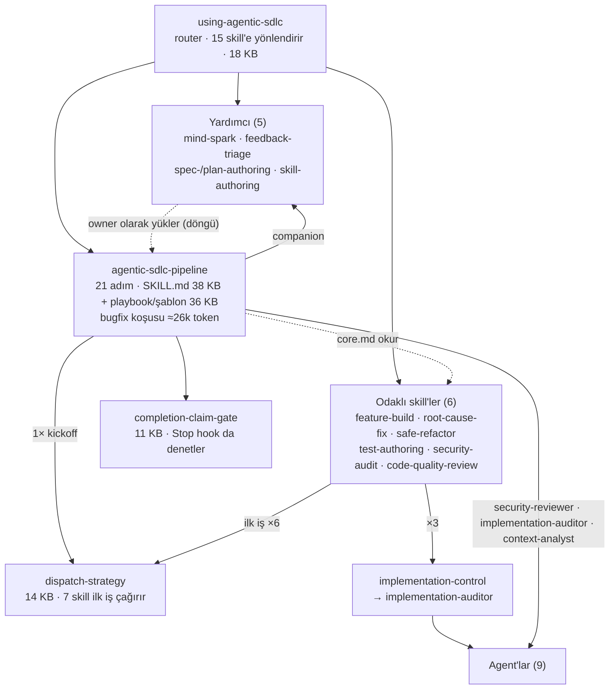

# agentic-sdlc — Durum Analizi ve Entegrasyon Raporu

14 Kasım 2026

## Özet

agentic-sdlc 0.6.0, bizim kurduğumuz kitin büyük kısmını zaten içeriyor; kiti olduğu gibi taşımak çakışma yaratır. Doğru sıra: önce kütüphanenin kendi karışıklığını azaltmak, sonra orkestrasyonu `dispatch-strategy` içinde isteğe bağlı bir yürütme modu olarak eklemek.

- **Skill'ler birbirini zorunlu çağırıyor.** 6 odaklı skill ilk eylem olarak `dispatch-strategy`'yi, 3'ü sonda `implementation-control`'ü çağırıyor. Pipeline ile `mind-spark` / `feedback-triage` arasında iki yönlü çağrı yolu var. 16 skill arasında 25 karşılıklı referans çifti bulunuyor.
- **Talimat yükü ağır.** Bir bugfix için pipeline koşusu ≈106 KB (≈26k token) talimat yüklüyor; tek başına `root-cause-fix` ≈49 KB (≈12k token). SKILL.md'lerdeki ≈41 KB metin Claude Code dışındaki 6 runtime'a ait.
- **Bizim modelle temel çatışma.** Kütüphane kodu ve RED/GREEN koşularını main loop'a yaptırıyor; hook'lar test kanıtını yalnızca main loop kayıtlarından sayıyor. Bizim kitte Opus ne kod yazıyor ne test koşuyor.
- **Agent isim çakışması.** Kitteki `security-reviewer` ve `code-reviewer`, plugin'deki aynı adlı agent'larla çakışıyor; pipeline'ın beklediği bulgu formatı bozulabilir.
- **Repo ve sürüm dağınık.** Asıl repo public 0.6.0; private arşive yayından sonra PR girmiş ve 129 ortak dosya farklı. 0.5.0 ve 0.6.0 release ledger'ları do-not-publish; iki pipeline prosedürü son koşuda FAIL.

**Verilmesi gereken temel karar:** main loop kod yazmaya devam mı edecek, yoksa orkestratör-only mi olacak? Diğer her şey bu karara bağlı (bkz. Seçenekler).

## Envanter ve repo durumu

Asıl repo public `MrBekoX/agentic-sdlc` (0.6.0, son merge 22 Ekim, PR #11). `agentic-sdlc-private`, 12 Ekim'deki history rewrite öncesinin arşivi (0.5.0, son merge 15 Ekim, PR #78).

| Bileşen | Public 0.6.0 | Not |
| --- | --- | --- |
| Skill | 16 | SKILL.md gövdeleri toplam ≈174 KB; description'lar 6,35 KB ve her oturumda context'te |
| Agent | 9 | spec-plan-author, spec-plan-critic, implementation-auditor, security-reviewer, code-reviewer, context-analyst, debugger, test-engineer, software-architect |
| Hook | 36 dosya | 5 runtime için ayrı hook json; flow, secret, branch, destructive-command ve completion-claim guard'ları |
| Workflow | 3 JS + 3 Rhai + 1 ZCode | spec-plan-draft, multi-lens-review, skill-draft |
| Contract | 11 | `contracts/skills/00–10` |
| Script | 25 | validator, eval runner'ları, release araçları |
| Test | 72 dosya, 2.150 test fonksiyonu | Çoğu talimat metni drift testi |
| Platform manifesti | 7 | Desteklenen: Claude Code, Codex · Deneysel: Cursor, Grok, ZCode, Kimi, Antigravity |
| `lessons.md` | 110 KB, 575 satır | Bakımcı belgesi; çalışma zamanında hiçbir skill yüklemiyor |

Private arşive yayından 3 gün sonra da PR girmiş. Public'te olmayan 8 dosya (eski Cursor hazırlık betiği, `hook-proposal.md` vb.) ve 129 farklı ortak dosya var; iki yerde geliştirme riski sürüyor.

## Skill çağrı grafiği

Kütüphanenin kendi kuralı tek yönlü bir graf istiyor: odaklı skill'ler birbirinden habersiz kalmalı ve pipeline'ı çağırmamalı (`docs/skill-boundaries.md`). Gerçek graf bunu iki yerde deliyor.



Pipeline companion olarak `mind-spark` ve `feedback-triage`'i çağırıyor; bu iki skill de pipeline'ı owner olarak yükleyebiliyor. `security-audit` düzeltme için `root-cause-fix` / `feature-build`'e, `feedback-triage` ise `root-cause-fix` / `test-authoring`'e yönlendiriyor.

| Çağıran | Çağrılan | Nasıl | Sorun |
| --- | --- | --- | --- |
| 6 odaklı skill | `dispatch-strategy` | "İlk eylem" zorunlu Skill çağrısı | Tek dosyalık işte bile +14 KB; aynı paragraf 6 kez kopya |
| `feature-build`, `root-cause-fix`, `safe-refactor` | `implementation-control` → `implementation-auditor` | Sonda zorunlu | Pipeline aynı gate'i doğrudan auditor'la yapıyor; iki yol |
| `agentic-sdlc-pipeline` | `dispatch-strategy`, `completion-claim-gate` | Kickoff'ta 1×, her claim öncesi | — |
| `agentic-sdlc-pipeline` | `mind-spark`, `feedback-triage` | Companion olarak | İkisi de pipeline'ı yükleyebiliyor: iki yönlü yol |
| `agentic-sdlc-pipeline` | 4 odaklı skill'in `core.md`'si | Read (SKILL.md değil) | Doğru ayrım; kopyalar parity testiyle tutuluyor |
| `security-audit` | `root-cause-fix`, `feature-build` | Düzeltme için yönlendirme | "Odaklı skill'ler birbirinden habersiz" kuralıyla çelişiyor |
| `plan-authoring` | `spec-authoring` | WHAT yoksa | Makul |
| `using-agentic-sdlc` | 15 skill | Router | 18 KB'ın ≈6 KB'ı diğer runtime'lara ait |

## Karışıklığın kaynakları

Karışıklığın çoğu tek bir sorundan değil, yedi yapısal alışkanlığın üst üste binmesinden geliyor.

1. **Her skill "ilk" diye tetikleniyor.** 16 description'ın 16'sı "This skill should be used first in any language…" ile başlıyor; ortalama ≈397 karakter. Ayırt edici fiil cümlenin ortasında kalıyor ve "Not for …" dışlama listeleri description'ları şişiriyor.
2. **Runtime adaptörleri gövdeye gömülü.** Pipeline SKILL.md'nin %43'ü (16,6 KB) runtime çağrı sözleşmesi. Tüm SKILL.md'lerde ≈41 KB metin Codex, Cursor, Grok, ZCode, Antigravity ve Kimi'ye ait; Claude Code oturumunda boşuna context'e giriyor ve her runtime değişikliği birden çok skill'e dokunuyor.
3. **Zorunlu paragraflar kopyalanmış.** Call-order guard paragrafı 6 skill'de, plugin-root paragrafı 3 skill'de aynen tekrar ediyor. Parity testleri kopyaları kilitlediği için tek bir değişiklik birden çok dosya ve test demek.
4. **Zorunlu alt-skill zinciri.** Odaklı bir bugfix'te `root-cause-fix` + `dispatch-strategy` + `implementation-control` + `completion-claim-gate` + core.md ≈49 KB yükleniyor; pipeline'da ≈106 KB. Yüklenen skill içeriği konuşmada kaldığı için uzun oturumlarda compaction erken geliyor.
5. **Aynı gate iki farklı yoldan.** Odaklı skill'ler kontrolü `implementation-control` skill'i üzerinden, pipeline doğrudan `implementation-auditor` agent'ı üzerinden yapıyor. Aynı kural iki biçimde yazılıp iki biçimde test ediliyor.
6. **Kanıtın çoğu metne dayalı.** 2.150 testin büyük kısmı talimat metninin varlığını kontrol ediyor; test dosyaları bunu kendileri "drift gate, not truth gate" diye tanımlıyor. Model davranışını ölçen Claude ve Codex pipeline prosedürleri son koşuda FAIL ve 0.6.0 üzerinde yeniden koşulmadı.
7. **Repo ve sürüm dağınık.** Private arşiv hâlâ PR alıyor; 0.5.0 ve 0.6.0 ledger'ları do-not-publish. Ledger'a göre PR ref'leri üzerinden kişisel veri hâlâ erişilebilir (`history_private_path_finding` FAIL).

## Hook'lar ve main loop kontratı

Flow hook'ları kanıtı yalnızca main loop'un kendi kayıtlarından sayıyor; bir subagent'ın koştuğu test kanıt sayılmıyor. Bu, "Opus kod yazmaz, Sonnet yazar" modelinin önündeki teknik engel.

- **Kanıt filtresi:** `hooks/flow-evidence.mjs` içindeki `isTopLevel`, sidechain (subagent) kayıtlarını kanıt dışı tutuyor.
- **Test adımları:** `hooks/flow-requirements.json`'da pipeline akışının `red-first` (kaynak düzenlemeden önce test koşusu) ve `tests` adımları `command:testCommand` kanıtı istiyor. `root-cause-fix` ve `feature-build`'de `tests`, `safe-refactor`'da `characterization` adımı aynı kanıtı bekliyor.
- **Engelleme varsayılan olarak kapalı:** `AGENTIC_FLOW_GATE_BLOCK` ya da `AGENTIC_FLOW_ORDER_BLOCK` açık değilse hook'lar yalnızca uyarıyor.
- **Talimat düzeyinde aynı kural:** pipeline "RED/GREEN runs stay in the main loop" ve "TDD evidence file'ı yalnızca main loop yazar" diyor. `dispatch-strategy` de "Interdependent code stays in the main loop" ve "No coordinator agent" kurallarını koyuyor.

**Sonuç:** Bizim modelde testleri `test-writer`, `implementer` ve `gate-runner` koşuyor. Bu yüzden `red-first`, `tests` ve `characterization` adımları her koşuda eksik görünür; engelleme açıksa Stop hook oturumun bitmesine izin vermez.

## Kesişim haritası

Bizim kitin dört parçasının kütüphanede birebir karşılığı var. Gerçekten yeni olanlar model/effort politikası, "Opus kod yazmaz" kuralı ve `implementer` / `gate-runner` rolleri.

| Bizim parça | agentic-sdlc karşılığı | Fark | Taşınırsa |
| --- | --- | --- | --- |
| `orkestrator` · mod seçimi | `dispatch-strategy` | Aynı 4 mod, aynı maliyet sırası. Bizde ek olarak model yönlendirme (Opus/Sonnet), effort rubriği ve escalation, faz sınırında mod geçişi, uygunluk kontrolü ve fallback var | `dispatch-strategy`'ye bölüm olarak eklenir |
| `orkestrator` · "Opus kod yazmaz" | Yok; tersi kural geçerli (main loop kod yazar) | Temel kontrat farkı | İsteğe bağlı mod olmalı; hook kanıt kuralı güncellenmeli |
| `agentic-sdlc` · 11 faz | `agentic-sdlc-pipeline` · 21 adım | Onlarınki daha sıkı: spec/plan artifact + validator, insan review gate'leri, TDD evidence dosyası, `implementation-auditor` | Bizim pipeline taşınmaz; pipeline'a mod-başına runtime eklenir |
| `implementer` | Yok (main loop) | — | Yeni agent |
| `test-writer` | `test-engineer` (strateji önerir, yazmaz) | Rol farkı | Yeni agent ya da `test-engineer` genişletilir |
| `security-reviewer` | `security-reviewer` | Aynı isim, farklı rapor formatı | Bizimki atılır |
| `code-reviewer` | `code-reviewer` | Aynı isim | Bizimki atılır |
| `gate-runner` | Yok (Step 15 main loop'ta) | — | Yeni agent; hook kanıtı uyarlanır |
| `phase-lead` | Yok; "No coordinator agent" kuralı yasaklıyor | Felsefe çatışması | Ya kural gevşer ya `phase-lead` yalnızca TEAM modunda kalır |
| Hipotez takımı | Hipotez başına bir `debugger` (dispatch-strategy) | Benzer | Birleştirilir |
| `merge_yetkisi` kuralı | Contract 08: commit/push/PR/merge yalnızca açık kullanıcı isteğiyle | Eşdeğer | Taşımaya gerek yok |
| `orchestrator-lessons.md` | `lessons.md` (bakımcı belgesi) | Farklı amaç | Ayrı kalır |

## Çatışmalar ve riskler

Kiti mevcut hâliyle agentic-sdlc ile aynı makineye kurmak, hata vermeden davranışı değiştirir.

- **Agent adı önceliği:** Claude Code'da aynı adlı subagent'larda yüksek öncelikli konum kazanıyor; `~/.claude/agents/` (4) plugin `agents/` dizininden (5) önce geliyor. Pipeline `security-reviewer`'ı kısa adla çağırırsa bizimki çözülebilir. Bu durumda pipeline'ın beklediği `Severity | Category | File:Line | Risk | Recommendation` tablosu yerine `SEC-1` formatı döner ve gate eşleşmez. Kısa adın plugin agent'ıyla çakışma durumu dokümanda açıkça yazılmıyor; kendi sürümünde doğrulanmalı.
- **İki giriş noktası yarışır:** `/agentic-sdlc` (bizim süreç skill'i) ve `agentic-sdlc-pipeline` aynı tür isteğe tetiklenir; ikisinin description'ı aynı isteğe aday olur.
- **Zorunlu dispatch adımı:** Bizim orkestratör `dispatch-strategy`'yi çağırmıyor. Pipeline akışı aktifse `dispatch` adımı (block) eksik kalır.
- **Hook uyarıları:** Bizim modelde her koşuda test adımları eksik görünür (önceki bölüm); engelleme açıksa oturum Stop'ta takılır.
- **Felsefe çatışması:** `phase-lead`, "No coordinator agent" ve "Never wholesale-delegate a multi-step skill" kurallarıyla doğrudan çelişiyor.

## Seçenekler ve öneri

Önerim B: önce kütüphaneyi sadeleştir, sonra orkestrasyonu `dispatch-strategy`'de isteğe bağlı bir "delegated execution" modu olarak ekle. Mevcut gate'ler korunur, ama Opus/Sonnet ayrımı tek sistemde çalışır.

| Seçenek | Ne yapılır | Artı | Eksi |
| --- | --- | --- | --- |
| A. Kiti ayrı tut | agentic-sdlc'ye dokunulmaz; kit kişisel `~/.claude`'da kalır, çakışan agent'lar yeniden adlandırılır | Hızlı, düşük risk | İki sistem yan yana; giriş noktaları yarışır |
| B. İsteğe bağlı mod olarak ekle (önerilen) | `dispatch-strategy`'ye model/effort politikası ve delegated execution; `implementer`, `test-writer`, `gate-runner` agent'ları; hook'lar bu agent'ların sidechain test komutlarını kanıt sayar | Tek sistem; gate'ler korunur | Hook, test ve eval değişikliği; 0.7.0 kapsamında |
| C. Pipeline'ı bizim modelle değiştir | Main loop kod yazmaz; `phase-lead` serbest | En temiz orkestrasyon | Contract 00–10, 2.150 test, hook'lar ve eval'lar yeniden yazılır; en yüksek risk |

Her seçenekten önce yapılması gereken sadeleştirme:

1. Runtime adaptörlerini SKILL.md'den `references/runtime-<ad>.md` dosyalarına taşı; SKILL.md'de tek satırlık yönlendirme kalsın (pipeline'da ≈16 KB düşer).
2. Call-order guard ve plugin-root paragraflarını tek bir ortak referansa al; kopyaları ve parity yükünü kaldır.
3. Description'ları "used first" kalıbından arındır; ayırt edici fiil başa gelsin.
4. Private repoyu GitHub'da read-only arşive çevir; geliştirme yalnızca public'te sürsün.
5. Pipeline prosedürlerini 0.6.0 üzerinde yeniden koştur; FAIL nedeni netleşmeden yeni mod ekleme.

Kararlar:

- [ ] Main loop kod yazmaya devam mı edecek (B), yoksa orkestratör-only mi olacak (C)? Middleware chain'de varsayılan değişmiyor; delegated mod P6'da isteğe bağlı geliyor (bkz. Middleware chain ile ilişki).
- [ ] Yeni mod 0.7.0'a mı girsin, yoksa önce yalnızca sadeleştirme içeren bir release mi çıksın? 0.7.0 middleware chain'in P5'iyle çıkıyor; P6'nın sürümü o zaman belirlenecek.
- [x] Private repo arşivlensin mi? Evet, 14 Kasım'da arşivlendi.
- [x] Bu rapordaki fazlar mı, middleware chain mi? Middleware chain ana plan (14 Kasım, bakımcı kararı).

## Middleware chain ile ilişki

Bu rapor public `main` (`52a2ad1`) okunarak yazıldı. O sırada `feat/middleware-chain` dalındaki yeniden tasarım commit'lenmemişti ve tasarım notları (`docs/agentic-sdlc/notes/2026-10-22-middleware-chain-design.md`, `…-plan.md`, `2026-10-22-runner-contract.md`) git'e girmiyordu. Bu yüzden rapor o işi görmedi.

Tasarım 22 Ekim'de bakımcı kararıyla başladı, çünkü düzyazı düzeltmeleri iki turda da canlı koşuda 0/6 almıştı. Düzyazı pipeline'ın yerine Python standart kütüphanesiyle yazılmış bir runner (`scripts/sdlc.py`), JSON akış manifestleri (`flows/`) ve birbirini çağırmayan adım dosyaları geliyor. Zincir router → strateji → akış gövdesi şeklinde. Model her adımda runner'ın verdiği kartı okuyor, işi yapıyor ve bir sonraki adımı yine runner'dan alıyor.

14 Kasım'da bakımcı middleware chain'i ana plan olarak seçti. Bu raporun tespitleri onun gereksinim listesi oldu. Aşağıdaki "Claude Code uygulama planı"nın Faz 1–6'sı ayrı PR'lar olarak uygulanmayacak: middleware'in P3 aşaması 16 skill'i giriş noktası artı adım dosyaları olarak baştan yazıyor, düzyazı pipeline üzerindeki değişiklikler orada silinirdi.

| Rapor fazı | Middleware chain karşılığı | Durum |
| --- | --- | --- |
| Faz 1 — Runtime adaptörleri | Runtime farkları runner'ın yetenek tablosunda (`flows/_shared.json`) ve motor adaptörlerinde; adım dosyalarında runtime dalı yasak; kart + adım gövdesi ≤ 8 KB | P2–P3'te kapsanıyor |
| Faz 2 — Kopya paragraflar | "Önce `dispatch-strategy`" paragrafları siliniyor; strateji her akışın başında bir kez koşan adım. Plugin kökünü runner her kartta `root=` olarak yazıyor | P3'te kapsanıyor |
| Faz 3 — Description'lar | Tasarımda yalnızca "daraltılmış description" var | Eksik; aşağıdaki kabul ölçütleri Görev 17'ye eklenecek |
| Faz 4 — Çağrı grafiği ve döngüler | Skill skill çağırmıyor (bağımsızlık testi); denetim tek `audit` adımı; `security-audit` ve `feedback-triage` tek adımlı akış; `mind-spark` `intent` adımı | P3'te kapsanıyor |
| Faz 5 — Davranışı ölç | Runner'ın kaydettiği duruma bakan değerlendirici ve canlı koşular | P4'te kapsanıyor |
| Faz 6 — Delegated execution | Tasarımda yok. Engeli kalkıyor: test kanıtını runner `sdlc run` ile kendisi kaydediyor ve transcript okuyan flow hook'ları kaldırılıyor; "yalnızca main loop'un testi sayılır" kuralı ortadan kalkıyor | Eksik; aşağıdaki P6 olarak eklenecek |

Döngüler tasarımda yapısal olarak sınırlı: adım başına en fazla 3 ziyaret (`implement` 5, `strategy` 1), koşu başına 60 geçiş, ilerleme olmadan 3 tekrarda durma, spec/plan döngüsü 3 tur (sert sınır 5) ve aynı eleştiri tekrar gelirse erken durma, güvenlik düzeltmesi 3 tur. Bugünkü pipeline'daki test, güvenlik ve audit düzelt-tekrar döngülerinin sınırı yok; middleware bunları da kapatıyor.

Routing'deki q3 çelişkisi (dışa aktarma endpoint'i, beklenen `feature-build`) de burada çözülüyor. Tasarımın D8 kararına göre risk akışı değil biçimi değiştiriyor: riskli yüzeyler her zaman onaylı biçimle koşuyor. Yani beklenti "`feature` akışı, onaylı biçim"; çelişki bugünkü router metninde ve Görev 17'de router yeniden yazılırken giderilecek.

**Plana eklenecek maddeler.** Plan notu git'e girmiyor ve bu maddeler ona henüz eklenmedi; şimdilik burada duruyor:

- Görev 17 (giriş noktaları, router, `dispatch-strategy`) kabul ölçütleri:
  - Hiçbir description "This skill should be used first" ile başlamıyor; ayırt edici fiil başta; en fazla iki "Not for …" maddesi.
  - Her description en fazla 250 karakter, 16'sı toplam en fazla 4 KB.
  - Router riskli feature işini onaylı biçimle `feature` akışına gönderiyor, `full`'a değil; q3 `feature-build` kalıyor.
  - Görevden önce ve sonra Baseline'daki komutlarla trigger smoke ve routing eval koşuluyor; sonuç Baseline'dan kötü değil (Claude trigger 13/16, Codex trigger 16/16, routing ikisinde 14/15). Haiku'ya özgü bir kaçış, description sorunu sayılmadan önce Sonnet'te ya da `--runs 3` ile doğrulanıyor.
- Yeni P6, Görev 23 — model/effort politikası ve isteğe bağlı delegated execution:
  - P4'ün canlı koşuları iki runtime'da da geçmeden başlamıyor.
  - Strateji adımına effort rubriği (low → max), escalation, kod yazan agent'lara Sonnet ve her agent çağrısında açık effort.
  - İsteğe bağlı `delegated` seçeneği; varsayılan değişmiyor. Kodu `implementer`, testleri `test-writer` (ya da test yazabilen `test-engineer`) yazıyor; test ve gate komutlarını `gate-runner` koşuyor. Hepsi testleri `sdlc run` ile koştuğu için kanıtı kimin başlattığından bağımsız olarak runner kaydediyor.
  - Rapor formatı: bare komut, exit code, çıktı kuyruğu. "No coordinator agent" kuralı kalıyor; `phase-lead` yok.
  - Testler: sub-agent'ı olmayan runtime'da `delegated` reddediliyor ya da degraded kaydediliyor; delegated agent'ın başlattığı `sdlc run` `run_recorded`'ı karşılıyor, `sdlc run` dışındaki test koşusu karşılamıyor. Canlı: delegated prosedür vakası Claude Code'da geçiyor (bakımcı onayıyla).

**Durum (14 Kasım).** P1'in Görev 1–4 ve 8a'sı `feat/middleware-chain` üzerinde iki yerel commit: `5b21df4` (0.6 düzeltme turu) ve `cdd0799` (runner WIP). Push edilmedi. `cdd0799`'un temiz bir WSL klonunda hızlı gate: `bump_version`, `check_all` ve `harness` exit 0; unittest 2.455 test, 1 FAIL, 20 skip. FAIL eden `test_documented_script_count_matches_repo`: yeni `scripts/sdlc.py` README ve plugin README'nin script listesinde yok. Görev 5–22 başlamadı; sıradaki iş Görev 5 (durum, motor ve CLI çekirdeği).

## Claude Code uygulama planı

> **Not (14 Kasım):** Bu plan middleware chain'den önce yazıldı ve artık uygulanmayacak; fazların nereye taşındığı yukarıdaki "Middleware chain ile ilişki" bölümünde. Faz 0 yapıldı (bkz. Baseline).

Plan öneri B'yi esas alıyor: önce sadeleştirme (Faz 1–5), sonra isteğe bağlı delegated execution modu (Faz 6). C seçilirse yalnızca Faz 6 değişir. Her faz ayrı bir branch ve PR; her fazdan sonra hızlı gate koşulur:

```bash
python3 scripts/bump_version.py --check
python3 scripts/check_all.py
python3 tests/skills/harness.py
python3 -m unittest discover -s tests -v
```

1. **Faz 0 — Hazırlık**
   - Private repoyu GitHub'da arşivle (Settings → Danger Zone → Archive); geliştirme yalnızca public'te sürsün.
   - Bu sohbetteki kiti `~/.claude/agents/` altına kurduysan `security-reviewer.md` ve `code-reviewer.md`'yi kaldır (isim çakışması).
   - Bu raporu repoya `docs/analysis/2026-11-14-durum-analizi.md` olarak ekle.
   - Baseline: hızlı gate çıktısı, SKILL.md boyutları, description uzunlukları ve trigger/routing eval sonuçlarını kaydet.
2. **Faz 1 — Runtime adaptörlerini SKILL.md'den çıkar** (`refactor/runtime-adapters-out-of-skills`)
   - Pipeline'ın "Runtime invocation contract" bölümündeki Codex, ZCode, Grok, Cursor ve Antigravity paragraflarını `skills/agentic-sdlc-pipeline/references/runtime-<ad>.md` dosyalarına taşı. SKILL.md'de runtime başına tek satır kalsın: "Runtime X ise önce `references/runtime-x.md`'yi oku."
   - Aynısını `using-agentic-sdlc`, `dispatch-strategy`, `spec-authoring`, `plan-authoring`, `mind-spark` ve `skill-authoring` için yap.
   - Claude Code'da kütüphanenin kendi `skill-authoring` skill'iyle çalış.
   - Metin sabitleyen drift testleri (ör. `tests/test_pipeline_zero_delegation.py`) kırılacak; beklenen literalleri yeni dosyalara taşı, testleri silme.
   - Bitti: hızlı gate yeşil, pipeline SKILL.md ≈22 KB'ın altında, Codex trigger eval'ı gerilemiyor.
3. **Faz 2 — Kopya paragrafları tekilleştir** (`refactor/shared-skill-preamble`)
   - Call-order guard: 6 skill'de tek cümle kalsın ("İlk iş `dispatch-strategy`'yi çağır"); gerekçe ve istisnalar tek bir ortak referansa taşınsın.
   - Plugin-root paragrafını `docs/runtime-adapter.md`'deki tek tanıma bağla.
   - İsteğe bağlı: `hooks/flow-requirements.json`'da odaklı akışlara da `dispatch` adımı ekleyip kuralı metinden hook'a taşı (pipeline'da zaten var).
   - Bitti: harness ve parity testleri yeni yapıya göre güncel ve yeşil.
4. **Faz 3 — Description'ları yeniden yaz** (`fix/skill-descriptions`)
   - "This skill should be used first in any language" kalıbını kaldır; ayırt edici fiil başa gelsin; "Not for …" listesi en fazla 2 madde; hedef ≤250 karakter.
   - Önce ve sonra: `python3 scripts/run_all_trigger_evals.py --runtime both --smoke` ve `scripts/run_routing_eval.py`.
   - Bitti: trigger ve routing sonuçları baseline'dan kötü değil; toplam description ≤4 KB.
5. **Faz 4 — Çağrı grafiğini düzelt** (`fix/skill-call-graph`)
   - `security-audit` düzeltme için başka skill çağırmasın; bulguyu raporlayıp uygun skill'i kullanıcıya önersin.
   - `mind-spark` ve `feedback-triage` pipeline içinden çağrıldıklarında owner yüklemesin, sonucu pipeline'a döndürsün (döngü kırılır).
   - Tek audit yolu: odaklı skill'ler de pipeline gibi `resolve_work_package.py` + `implementation-auditor`'ı doğrudan çağırsın; `implementation-control` yalnızca "işimi denetle" isteğinin giriş noktası kalsın.
   - `docs/skill-boundaries.md`'deki Owns / Does Not Own tablosunu ve kapalı Skill-çağrı listesini güncelle.
   - Bitti: skill'ler arası Skill çağrıları yalnızca `dispatch-strategy` ve `completion-claim-gate`'e gidiyor; harness yeşil.
6. **Faz 5 — Davranışı ölç**
   - Claude ve Codex pipeline prosedür eval'larını canlı modda koştur (`scripts/run_procedure_eval.py`, modlar `docs/testing.md` → Procedure evals).
   - FAIL nedenlerini root-cause'la, sonuçları release ledger'ına yaz.
   - Bitti: iki pipeline prosedürü de PASS. PASS olmadan Faz 6'ya geçme.
7. **Faz 6 — Delegated execution modu, 0.7.0** (`feat/delegated-execution`)
   - `dispatch-strategy`'ye "Model ve effort politikası" bölümü ekle: effort rubriği (low → max), escalation, kod yazan agent'lara Sonnet, effort'un her çağrıda açıkça verilmesi (Claude Code v2.1.292+).
   - İsteğe bağlı tetik: `mode:delegated` verildiğinde main loop kod yazmaz ve test koşmaz; varsayılan davranış değişmez.
   - Yeni plugin agent'ları: `implementer`, `test-writer` (ya da yazabilir hâle getirilmiş `test-engineer`), `gate-runner`. Bu sohbetteki kit tanımları başlangıç noktası; rapor formatı pipeline'ın kanıt kuralına uysun (bare komut, exit code, çıktı kuyruğu).
   - `hooks/flow-evidence.mjs`: sidechain test komutunu, onu başlatan `Agent` çağrısının `subagent_type`'ı izinli listedeyse (`implementer`, `test-writer`, `gate-runner`) kanıt say. `tests/test_flow_guards.py`'ye pozitif ve negatif vaka ekle (izinsiz bir agent'ın testi sayılmamalı).
   - TDD evidence dosyası: delegated modda bloğu agent yazar, hook gerçek komutla doğrular.
   - Pipeline Step 8–13'e delegated varyantı ekle. `phase-lead` bu sürümde yok; "No coordinator agent" kuralı korunur.
   - Procedure eval'a delegated vaka ekle; `docs/skill-boundaries.md`, `docs/runtime-adapter.md`, CHANGELOG ve 0.7.0 ledger'ını güncelle.
   - Bitti: hızlı gate ve yeni flow-guard testleri yeşil; delegated procedure eval PASS.
8. **Faz 7 — Kişisel kiti emekliye ayır**
   - `~/.claude/agents/` altındaki kit dosyalarını kaldır; plugin'i yerel dizinden kurup delegated modu gerçek bir görevde dene.

## Kaynaklar

Repo dosyaları public `main` üzerinden (commit `52a2ad1`, 22 Ekim) okundu.

- [docs/skill-boundaries.md](https://github.com/MrBekoX/agentic-sdlc/blob/main/docs/skill-boundaries.md)
- [skills/dispatch-strategy/SKILL.md](https://github.com/MrBekoX/agentic-sdlc/blob/main/skills/dispatch-strategy/SKILL.md)
- [skills/agentic-sdlc-pipeline/SKILL.md](https://github.com/MrBekoX/agentic-sdlc/blob/main/skills/agentic-sdlc-pipeline/SKILL.md)
- [hooks/flow-requirements.json](https://github.com/MrBekoX/agentic-sdlc/blob/main/hooks/flow-requirements.json)
- [hooks/flow-evidence.mjs](https://github.com/MrBekoX/agentic-sdlc/blob/main/hooks/flow-evidence.mjs)
- [docs/release-evidence-0.6.0.md](https://github.com/MrBekoX/agentic-sdlc/blob/main/docs/release-evidence-0.6.0.md)
- [docs/publication/history-map.md](https://github.com/MrBekoX/agentic-sdlc/blob/main/docs/publication/history-map.md)
- [Claude Code — Subagents (aynı ad önceliği)](https://code.claude.com/docs/en/sub-agents)

## Baseline

Faz 0 ölçümü, 14 Kasım 2026. Kaynak: public `main` `52a2ad1` ve Faz 0 değişiklikleri (bu rapor, `.gitignore` istisnası, test güncellemesi). Gate ve eval'lar WSL Ubuntu'da (Python 3.12.3, Node 24.14.0), bu commit'in temiz bir klonunda koşuldu.

### Faz 0 maddeleri

| Madde | Durum |
| --- | --- |
| Private repoyu arşivle | Yapıldı. `MrBekoX/agentic-sdlc-private` GitHub'da arşivlendi (`isArchived: true`). Son push 25 Ekim'deydi; açık dependabot PR #79 salt-okunur kaldı. Referans repo public `MrBekoX/agentic-sdlc`. |
| Çakışan kit agent'larını kaldır | Gerek yok. `~/.claude/agents/` Windows'ta boş, WSL'de yok; plugin agent'larıyla aynı adı taşıyan dosya bulunmadı. |
| Raporu repoya ekle | Eklendi, commit'lenmedi. `.gitignore`'daki `docs/*` kuralı raporu yok sayıyordu. `!docs/analysis/`, `docs/analysis/*` ve `!docs/analysis/*.md` eklendi. `!` satırlarını birebir kilitleyen `tests/test_release_readiness_docs.py` güncellendi (önce RED, sonra GREEN). Takip edilen her dosya gibi bu rapor da release arşivine girer. |
| Baseline | Bu bölüm. |

### Hızlı gate

| Komut | Sonuç |
| --- | --- |
| `python3 scripts/bump_version.py --check` | exit 0 · `version_check=passed`, 16 sürüm alanı 0.6.0 |
| `python3 scripts/check_all.py` | exit 0 · `check_all=passed`, 16 skill, `validator_tests=pass` |
| `python3 tests/skills/harness.py` | exit 0 · `skills_eval=passed`: 16 skill, 9 agent, 11 contract, 3 workflow |
| `python3 -m unittest discover -s tests -v` | exit 0 · 2.145 test, OK, 13 skip, 405 s |

Bu Baseline bölümü eklendikten sonra gate bir kez daha koşuldu. Sonuç aynıydı: 4/4 exit 0, 2.145 test OK, 13 skip, 509 s.

13 skip'in hepsi ortamdan kaynaklanıyor: 6'sı yalnızca Windows'ta anlamlı, 3'ü Grok/Kimi CLI'ı kurulu olmadığı için, 2'si `AGENTIC_NATIVE_TRUST_SMOKE=1` gerektiren opt-in testler. Kalan 2'si için ledger'da taşınmış bir Codex routing PASS'i ve yerel dogfooding planı yok.

Yarıda kesilen bir ilk koşuda, aynı anda başka bir test de koşarken, `test_codex_current_rollout.BR6SafeGrammarTests.test_cluster_checks_are_linear` FAIL verdi (1 saniyelik süre eşiği). Temiz koşuda geçti. Yük altında bu testte yanlış alarm beklenebilir.

### SKILL.md boyutları ve description uzunlukları

Boyutlar frontmatter dahil, bayt cinsinden. Description'ların hepsi ASCII; karakter sayısı bayt sayısına eşit.

| Skill | SKILL.md (B) | Description (karakter) |
| --- | ---: | ---: |
| agentic-sdlc-pipeline | 39.017 | 334 |
| code-quality-review | 6.658 | 419 |
| completion-claim-gate | 11.236 | 391 |
| dispatch-strategy | 15.011 | 376 |
| feature-build | 6.130 | 316 |
| feedback-triage | 14.536 | 316 |
| implementation-control | 10.577 | 722 |
| mind-spark | 4.683 | 449 |
| plan-authoring | 8.526 | 426 |
| root-cause-fix | 7.612 | 302 |
| safe-refactor | 6.226 | 492 |
| security-audit | 7.036 | 357 |
| skill-authoring | 12.749 | 382 |
| spec-authoring | 8.627 | 279 |
| test-authoring | 5.185 | 416 |
| using-agentic-sdlc | 18.049 | 375 |
| **Toplam** | **181.858** | **6.352** |

- Description ortalaması 397 karakter; en kısa 279 (`spec-authoring`), en uzun 722 (`implementation-control`).
- 16 description'ın 16'sı "This skill should be used first" ile başlıyor ve 16'sı da 250 karakterin üstünde.
- Faz hedeflerine göre: pipeline SKILL.md 39.017 B (Faz 1 hedefi ≈22 KB'ın altı); description toplamı 6.352 B (Faz 3 hedefi ≤4 KB).

### Trigger ve routing eval'ları

Canlı koşular WSL'de kurulu gerçek Claude Code ve Codex profilleriyle yapıldı. Bu profiller kendi ayarlarını, plugin'lerini ve MCP sunucularını da yüklüyor; profilde kurulu agentic-sdlc 0.6.0'a ek olarak klon `--plugin-dir` ile verildi. Hepsi tek örnek (smoke ya da `runs=1`). `docs/testing.md`'ye göre bu release kanıtı sayılmaz, ama Faz 3'teki önce/sonra karşılaştırması için yeterli.

| Eval | Runtime · model · effort | Sonuç | Kaçanlar |
| --- | --- | --- | --- |
| Trigger smoke (16 skill × ilk sorgu) | Claude Code 2.1.325 · Haiku 5.5 · low | 13/16 | `completion-claim-gate`, `mind-spark`, `using-agentic-sdlc`: pozitif sorgu, rate 0.00 |
| Trigger smoke (16 skill × ilk sorgu) | Codex 0.163.0 · gpt-5.6-luna · low | 16/16 | — |
| Routing (15 senaryo, runs 1) | Claude Code 2.1.325 · Haiku 5.5 · low | 14/15 | q5: beklenen `safe-refactor`, route yok |
| Routing (15 senaryo, runs 1) | Codex 0.169.0 · gpt-5.6-luna · low | 14/15 | q3: beklenen `feature-build`, `agentic-sdlc-pipeline`'a yükseltildi |

Notlar:

- **Codex modeli:** Runner'ların varsayılanı `gpt-5.4-mini` Codex kataloğunda yok; bakımcı kararıyla `gpt-5.6-luna` (low) kullanıldı. CLI iki batch arasında güncellendiği için trigger 0.163.0'da, routing 0.169.0'da koştu.
- **Claude effort:** Runner'lar Claude'a effort geçirmiyor, profil varsayılanı ise `effortLevel: xhigh`. Low iki yoldan verildi: `CLAUDE_CODE_EFFORT_LEVEL=low` ve PATH'in başında `claude --effort low "$@"` çalıştıran bir sarmalayıcı. stream-json init olayında effort alanı olmadığı için transcript'ten doğrulanamıyor; model `claude-haiku-5-5` olarak doğrulandı.
- **Baseline sayılmayan ilk koşu:** Profil varsayılanıyla (Claude Code 2.1.301, Haiku 5.5, xhigh) trigger smoke 14/16 çıktı. `mind-spark` kaçtı, `agentic-sdlc-pipeline` ölçülemedi: CLI "Can't access working directory" hatasıyla exit 1 verdi, model turu yok. O koşuda routing yalnızca ilk senaryoyu (`--smoke`) koştu ve iki runtime'da da 1/1 geçti.
- **Description yeniden yazımı için (eski Faz 3, artık middleware Görev 17):** Haiku'daki kaçışları description sorunu saymadan önce Sonnet'te ya da `runs≥3` ile doğrulayın; tek örnek gürültülüdür.

Görev 17'den önce ve sonra aynı ayarlarla tekrar etmek için komutlar aşağıda. Runner'lar artık effort'u kendileri geçiriyor: `--reasoning-effort` Claude'a `--effort`, Codex'e `model_reasoning_effort` olarak gidiyor. Bu yüzden sarmalayıcıya ve env değişkenine gerek yok. `run_all_trigger_evals.py`'nin Codex varsayılanı da `gpt-5.6-luna` oldu.

```bash
python3 scripts/run_all_trigger_evals.py --runtime both --smoke --reasoning-effort low
python3 scripts/run_routing_eval.py --eval-set tests/skills/routing/using-agentic-sdlc.json --runtime claude --reasoning-effort low --runs 1
python3 scripts/run_routing_eval.py --eval-set tests/skills/routing/using-agentic-sdlc.json --runtime codex --model gpt-5.6-luna --reasoning-effort low --runs 1
```
